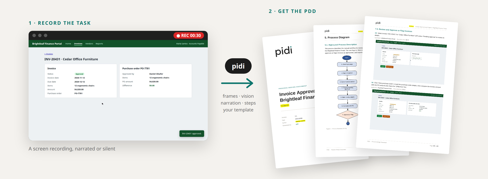
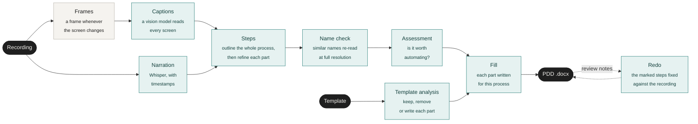
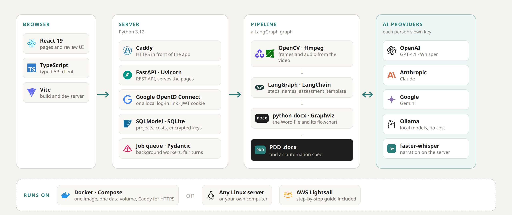

<div align="center">


# Pidi

### Record yourself doing a task. Get the Process Design Document.

**From a screen recording to an automation-ready PDD in Word, with steps, screenshots, a flowchart and a viability assessment, in minutes.**

[](LICENSE)
[](requirements.txt)
[](web/)
[](web/frontend/)
[](pipeline.py)
[](Dockerfile)
[](#faq)

**OpenAI · Claude · Gemini · Ollama**

[Example](#example) · [Quick start](#quick-start) · [How it works](#how-it-works) · [Tech stack](#tech-stack) · [Configuration](#configuration) · [FAQ](#faq)

<br />



</div>

---

A **Process Design Document (PDD)** is what RPA and automation teams write before they automate a process: what it's for, a flowchart, every step with a screenshot, the applications, inputs, business rules and exceptions. Writing one by hand takes hours of pausing a recording and copying screenshots.

Pidi watches the recording, listens to the narration if there is one, and writes the document for you, in your company's own Word template or in Pidi's. Then you review it: say what's wrong in a step, and the AI checks the recording again and fixes it.

## Features

| | |
|---|---|
| **Steps with screenshots** | Keeps a frame whenever the screen changes, reads each one with a vision model, and writes numbered steps with the application, the recorded time and the right screenshot. |
| **Your template** | Upload your company's PDD template (.docx). Pidi works out which parts are fixed text, which are examples to remove and which to write, and keeps its cover, styles and numbering. |
| **Review and redo** | Approve the steps or say what's wrong in each one ("this is two steps", "a step is missing after it"). The AI fixes those steps against the recording; every version is kept and can be undone. |
| **Never invents** | What the recording doesn't say (contacts, volumes, versions) is left as a highlighted "to be completed" marker for the author. |
| **ROI and viability** | An assessment of whether the process is worth automating, and an ROI section (hours saved, payback, FTE) from your own cost assumptions. |
| **Automation spec** | The process as Markdown with screenshots, ready for an AI agent or a developer that builds the automation. |
| **Bring your own AI** | OpenAI, Anthropic (Claude), Google (Gemini) or a local Ollama, each person with their own key, and a dashboard of what every project cost. |
| **Any language** | English and Brazilian Portuguese built in; any other language is translated on first use. |

## Example

[`examples/`](examples/) holds a 77-second silent recording of an invented finance portal, where a clerk approves invoices that match their purchase order and flags one that doesn't. From it, Pidi wrote [this 15-page PDD](examples/invoice-approval-PDD.pdf) on OpenAI's default models:

| | Steps | Cost | Time |
|---|---|---|---|
| **First pass**: from the recording alone | 10 | $0.10 | 2 min |
| **One redo**: from three review notes, such as *"after opening the invoice, the clerk compares it with the purchase order"* | 14 | $0.02 | 25 s |

The redo added the purchase-order check and the rule behind the decision ("approve when the difference is $0.00"), and the viability assessment, written again from the corrected steps, went from *partial* to *good candidate*. See [`examples/README.md`](examples/README.md).

## Quick start

### Command line

The fastest way to try it: one recording in, one .docx out. Needs Python 3.12, `ffmpeg`, `graphviz` and an OpenAI API key.

```bash
sudo apt install ffmpeg graphviz          # macOS: brew install ffmpeg graphviz
git clone https://github.com/almeida-guilherme/Pidi.git && cd Pidi
python3 -m venv .venv && .venv/bin/pip install -r requirements.txt
echo "OPENAI_API_KEY=sk-..." > .env

.venv/bin/python main.py examples/invoice-approval.mp4                   # the example, English
.venv/bin/python main.py recording.mp4 --language pt-BR                  # another language
.venv/bin/python main.py recording.mp4 --template PDD_Template.docx      # your company's template
```

The document is written to `runs/<recording>-<date>/output/PDD_final.docx`, next to everything the run produced (frames, captions, transcript, the process model and a report with its cost).

### Website

The website adds accounts, projects, the review-and-redo page, company templates, ROI templates and the cost dashboard.

```bash
echo "PDD_LOCAL_LOGIN=true" >> .env       # log in with a link the server prints (your own machine only)
docker build -t pidi .
docker run --rm -p 127.0.0.1:8000:8000 --env-file .env -v pidi-data:/data pidi
```

Open the log-in link the server prints (`http://127.0.0.1:8000/api/auth/local?token=...`), then connect your AI provider on the **Account** page; keys are checked with the provider, stored encrypted and never shown again.

<details>
<summary><strong>Without Docker</strong></summary>

<br />

```bash
cd web/frontend && npm ci && npm run build && cd ../..     # Node 22, once
.venv/bin/uvicorn web.app:create_app --factory --host 127.0.0.1 --port 8000
```

</details>

<details>
<summary><strong>A site for other people (Google log-in, HTTPS)</strong></summary>

<br />

1. Create an OAuth client in [Google Cloud Console](https://console.cloud.google.com/) (APIs & Services → Credentials → OAuth client ID, Web application) with the redirect URI `https://<your site>/api/auth/google/callback`, and set `PDD_GOOGLE_CLIENT_ID` and `PDD_GOOGLE_CLIENT_SECRET`. Turn the local login off.
2. `compose.yaml` runs the app behind Caddy, which gets the HTTPS certificate: `docker compose up -d --build` with `PDD_DOMAIN` set. [`deploy/LIGHTSAIL.md`](deploy/LIGHTSAIL.md) walks through one small server step by step.
3. Recordings are often confidential company material: keep sign-up closed (`PDD_ALLOW_SIGNUP=false`) or limited to your domain (`PDD_SIGNUP_DOMAINS`), and back up the data volume.

</details>

## How it works



The model only decides what needs judgment. Code does the rest: numbering the steps, timing them from their frames, picking the screenshot files, fixing misread names, laying out the flowchart, and writing the Word file into the template. Every stage saves its result, so an interrupted run resumes where it stopped. Every option and stage is described in [`docs/reference.md`](docs/reference.md).

## Tech stack

<div align="center">

</div>

| Layer | Technologies |
|---|---|
| **Front end** | React 19, TypeScript, Vite, React Router |
| **Back end** | FastAPI, Uvicorn, SQLModel (SQLite), Pydantic, PyJWT, cryptography (Fernet) |
| **Pipeline** | LangGraph, LangChain, OpenCV, NumPy, Pillow, ffmpeg |
| **AI** | OpenAI (GPT-4.1, Whisper), Anthropic Claude, Google Gemini, Ollama, faster-whisper |
| **Documents** | python-docx, Graphviz |
| **Deployment** | Docker, Docker Compose, Caddy; a step-by-step guide for AWS Lightsail |
| **Tests** | pytest, with a synthetic screen recording and fake models (offline) |

## Configuration

Settings are environment variables, in `.env`. The main ones:

| Setting | Default | What it does |
|---|---|---|
| `OPENAI_API_KEY` | | The command line's key; on the website each person adds their own |
| `PDD_LOCAL_LOGIN` | `false` | Log in with a link the server prints, without Google |
| `PDD_OLLAMA_URL` | | Offers the server's Ollama to everyone, e.g. `http://localhost:11434` |
| `PDD_MODEL` · `PDD_STRUCTURE_MODEL` | `gpt-4.1-mini` · `gpt-4.1` | OpenAI's models for screenshots and for writing; other providers have their own |
| `PDD_ALLOW_SIGNUP` · `PDD_SIGNUP_DOMAINS` | `true` · any | Who can create an account |
| `PDD_RETENTION_DAYS` | `30` | Days until a finished project's recording is deleted; the document stays |

Every setting is listed in [`deploy/env.example`](deploy/env.example).

## FAQ

<details>
<summary><strong>How much does a document cost?</strong></summary>

<br />

About **$0.10 per minute of recording** on OpenAI's default models, paid to your provider with your own key. Pidi estimates the cost before you upload and shows what each project actually cost on the Dashboard. On a local Ollama model it costs nothing.

</details>

<details>
<summary><strong>Where do my recordings go?</strong></summary>

<br />

To your own server and to the AI provider whose key you connected, nowhere else. Recordings are deleted 30 days after their document is finished (`PDD_RETENTION_DAYS`), and each person can download or delete everything kept about them.

</details>

<details>
<summary><strong>Do I need to narrate the recording?</strong></summary>

<br />

No, but it helps a lot. The screens show *what* was done; the narration says *why*, and becomes the business rules and decisions. The example is silent, and its first draft missed exactly that, until one redo fixed it.

</details>

<details>
<summary><strong>Can it use my company's PDD template?</strong></summary>

<br />

Yes. Upload the .docx on the Templates page (or pass `--template` on the command line). Pidi analyses it once, shows what it decided for every part, and you can correct any decision before using it.

</details>

<details>
<summary><strong>How good are the steps?</strong></summary>

<br />

Usually close, but not final: always review them, which is what the review page is for. The [`evaluation/`](evaluation/) tools measure the steps against hand-checked cases, to catch changes that make them worse.

</details>

<details>
<summary><strong>Which providers are tested?</strong></summary>

<br />

OpenAI is used for real. Claude, Gemini, Ollama and the server-side Whisper are supported and covered by offline tests, but have had little real use so far: it's an early version, and reports are welcome.

</details>

## Development

```bash
OPENAI_API_KEY=unused .venv/bin/python -m pytest tests   # offline, with fake models
.venv/bin/python -m evaluation.run --repeats 3           # step quality vs. saved cases
cd web/frontend && npm run dev                           # pages with live reload
```

| Folder | What's in it |
|---|---|
| `pipeline.py`, `structure.py`, `template.py`, … | The pipeline: frames, captions, steps, templates, documents |
| `web/` | The FastAPI back end; `web/frontend/` is the React app |
| `evaluation/` | Cases and scoring for the quality of the steps |
| `examples/` | The sample recording, its PDD, and the script that records it |
| `docs/reference.md` | Every option, stage and setting in detail |

## Contributing

Issues and pull requests are welcome. Please run the tests before opening a pull request, and never commit real recordings or documents: they are usually confidential company material.

## License

[MIT](LICENSE) © 2026 Guilherme Almeida
